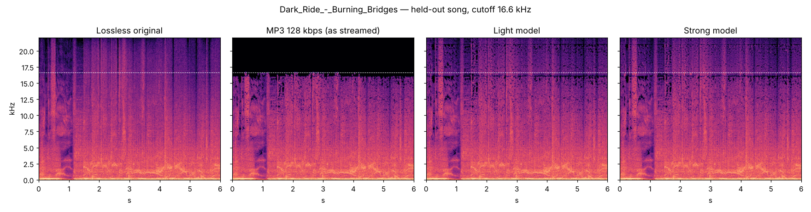

# Восстановление качества: модели

Здесь обучаются две модели, которыми плеер возвращает сжатым трекам срезанный верх (код в приложении — [`player/restore`](../../app/src/main/java/com/example/myapplication/player/restore)).

## Что делает модель

MP3 и AAC на 96–160 кбит/с отрезают всё выше 15–17 кГц: тарелки, «воздух» голоса, хвосты реверба. Плеер сначала слушает трек и ищет в его долгом спектре обрыв, который оставляет фильтр кодека (`detect_cutoff`). Нет обрыва ниже 18 кГц — трек не трогается вовсе, ни один сэмпл. MP3 192 и 320, AAC 256, lossless под это не попадают.

Над обрывом работает как SBR в HE-AAC, только громкость полос задаёт модель:

1. Полоса шириной до 5 кГц под срезом копируется вверх ступенями своей ширины. Сдвиг кратен 4 бинам при шаге в четверть кадра, так что фаза копии идёт так же, как у кадров.
2. Модель — GRU раз в 5,8 мс (кадр 1024, шаг 256) — слушает полосы под срезом и говорит, насколько громкой была каждая полоса над ним в оригинале, относительно 2 кГц под срезом.
3. Ответ модели смешивается пополам с фиксированной кривой (её наклон и уровень подобраны по обучающим данным и лежат в файле модели): на незнакомых песнях вместе они ошибаются меньше, чем порознь.
4. Каждая полоса копии ставится на эту громкость (одинаковое усиление на оба канала, поэтому стереокартина остаётся той, что под срезом) с примесью шума в фазе, растущей к верху; энергию, которую шум отнимает, возвращаем. Фильтр кодека гасит звук склоном, поэтому копия начинается на 12 бинов (~0,5 кГц) ниже среза и плавно нарастает к нему, а копируется из-под склона. Всё это прибавляется к звуку, задержанному на 768 сэмплов (17 мс).

| | Лёгкая | Мощная |
| --- | --- | --- |
| Полосы над 4 кГц | по 500 Гц (43 всего) | по 250 Гц (79 всего) |
| Сеть | Linear → GRU 96 → Linear | Linear → GRU 192 × 2 слоя → Linear |
| Весов | ~69 тыс. (270 КБ) | ~490 тыс. (2 МБ) |
| Минута стерео на одном ядре сервера (JVM) | ~0,9 с (~1,5%) | ~2,5 с (~4,2%) |
| Где | в APK, `assets/restore/light-v1.ycrm` | скачивается из [`models/restore`](../../models/restore) |

## Данные

[MUSDB18-HQ](https://zenodo.org/records/3338373) — lossless-записи (WAV, 44,1 кГц) со стемами. Миксы и ремиксы стемов со случайной громкостью кодируются так, как их отдают сервисы: `libmp3lame` 96/128/160 кбит/с, AAC 96/128 кбит/с через ffmpeg, плюс «кирпичный» срез на случайной частоте от 11 до 17,5 кГц. Две песни («Music Delta — Gospel», «Dark Ride — Burning Bridges») в обучение не попадают — на них проверяется качество.

**Лицензия данных:** аудио MUSDB18-HQ разрешено для некоммерческих исследований. Веса моделей обучены на нём; YouCloud бесплатный и некоммерческий, но при иной цели это стоит учитывать.

## Насколько это близко к оригиналу

На двух отложенных песнях, 14 сжатых версий по минуте, через весь тракт, как в приложении (`evaluate.py`):

| | Громкость полос над срезом | Спектральное расстояние над срезом |
| --- | --- | --- |
| Как есть | 49,3 дБ | 41,5 дБ |
| Фиксированная кривая (DSP) | 4,89 дБ | 10,01 дБ |
| Лёгкая | **4,56 дБ** | 9,91 дБ |
| Мощная | 4,70 дБ | **9,66 дБ** |



## Как пересобрать

```bash
pip install torch numpy scipy soundfile pyarrow matplotlib
python prepare.py <папка с parquet MUSDB18-HQ> pairs
python train.py pairs light light-v1.ycrm
python train.py pairs strong strong-v1.ycrm
python evaluate.py pairs light-v1.ycrm strong-v1.ycrm comparison.png
python vectors.py light-v1.ycrm ../../app/src/test/resources/restore/vectors.json
```

`light-v1.ycrm` кладётся в `app/src/main/assets/restore/`, `strong-v1.ycrm` — в `models/restore/`; его размер и SHA-256 — в `RestoreModelFiles.kt`, иначе приложение скачанный файл не примет.

Формат YCRM v1: `"YCRM"`, версия и длина заголовка (int32 LE), JSON-заголовок (полосы, размеры сети, список тензоров) и тензоры float32 LE в его порядке. Kotlin-реализация (`RestoreDsp`, `RestoreModel`) повторяет `dsp.py` и PyTorch; `RestoreDspTest` сверяет их на одних и тех же числах.

## Почему не готовые модели

| Модель | Почему нет |
| --- | --- |
| Apollo (Tencent / Tsinghua) | Обучена как раз на MP3-музыке, но ~1,3 млрд умножений на 10 мс канала (~260 млрд/с на стерео): в 5–10 раз медленнее реального времени на процессоре телефона. Внимание по полосам не каузально. |
| MPASCNet (2026) | Лучше и меньше Apollo (6,5 млн весов, CC-BY-4.0), но ~100 млрд умножений в секунду стерео, а двунаправленный GRU и внимание по всему 3-секундному куску дают задержку в секунды. |
| FlashSR (YatharthS) | 2 МБ и очень быстрая, но на вход берёт только 16 кГц и обучена на речи: у музыки она бы выбросила настоящие 8–16 кГц. FlashSR из статьи KAIST умеет музыку, но это ~640 млн весов. |
| MP-SENet, gtcrn, DeepFilterNet | Шумодавы для речи: верх музыке не возвращают. |
